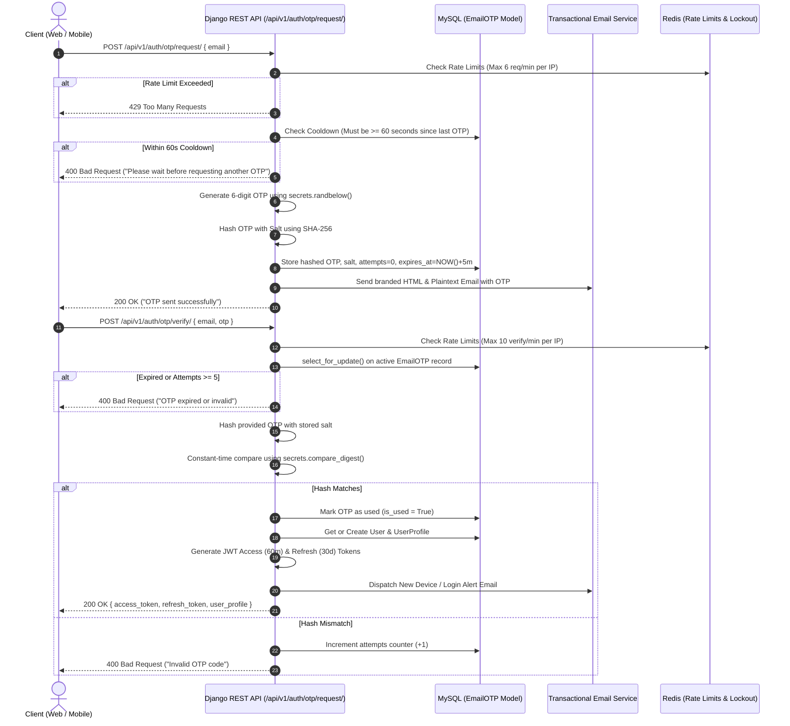

# Passwordless Authentication Architecture & Setup Guide

## 1. Overview & Security Philosophy

Traditional username/password authentication introduces significant attack vectors including credential stuffing, weak passwords, rainbow-table cracking, and password reuse. 

This platform implements a **strict passwordless authentication model** powered by:
1. **Cryptographic 6-digit Email OTP** for primary registration and login.
2. **Standard OAuth 2.0** (Google, GitHub, Facebook) with mandatory verified-email enforcement.
3. **Rotating JWTs (JSON Web Tokens)** with Redis-backed revocation/blacklisting.

---

## 2. Cryptographic Email OTP Flow



---

## 3. Cryptographic & Security Safeguards

### 3.1. Cryptographic Generation
OTPs are generated using Python's `secrets` module (operating system CSPRNG), ensuring non-predictability:
```python
import secrets
code = f"{secrets.randbelow(900000) + 100000:06d}"
```

### 3.2. Salted SHA-256 Storage
The raw OTP is never persisted to the database in plaintext. Each OTP is salted with 16 random cryptographic bytes before hashing:
```python
import hashlib, secrets
salt = secrets.token_hex(16)
hashed = hashlib.sha256((salt + code).encode('utf-8')).hexdigest()
```

### 3.3. Timing Attack Mitigation
Verification utilizes `secrets.compare_digest` to prevent side-channel timing attacks:
```python
is_valid = secrets.compare_digest(stored_hashed, candidate_hashed)
```

### 3.4. Concurrency & Race-Condition Protection
To prevent parallel verification race conditions (submitting multiple parallel verification requests before the attempts counter updates), the verification service acquires an exclusive row-level lock via Django's ORM:
```python
with transaction.atomic():
    otp_record = EmailOTP.objects.select_for_update().filter(
        email=email, is_used=False
    ).order_by("-created_at").first()
```

### 3.5. Expiration & Lockout Limits
- **TTL**: 5 minutes (300 seconds).
- **Cooldown**: Minimum 60 seconds between generation requests.
- **Max Attempts**: 5 invalid attempts permanently invalidates the OTP record.
- **Single Use**: Once successfully verified, `is_used` is set to `True` immediately inside the atomic transaction.

---

## 4. JWT Token Strategy

- **Access Token**:
  - Valid for **60 minutes**.
  - Passed via HTTP header: `Authorization: Bearer <access_token>`.
  - For WebSockets: Passed as query parameter `?token=<access_token>` or via HTTP cookie.
- **Refresh Token**:
  - Valid for **30 days**.
  - Issued with **Token Rotation** enabled: whenever a refresh token is exchanged for a new access token, the old refresh token is immediately blacklisted in Redis and a new refresh token is issued.

---

## 5. Security Alerts & Device Verification

Whenever an account is authenticated from an unrecognized IP address or user agent:
1. The system detects the new session.
2. An automated security alert email (`new_device_login.html`) is dispatched containing:
   - IP address.
   - User-Agent / Device details.
   - Timestamp in UTC.
   - Warning notice to contact security if unauthorized.

---

## 6. Account Recovery & Deletion

- **Account Recovery (`/api/v1/auth/account-recovery/`)**:
  - Allows users who have lost access to OAuth accounts or devices to initiate recovery via verified email OTP.
  - Automatically revokes all existing refresh tokens and active WebSocket sessions.
- **Account Deletion (`/api/v1/auth/delete-account/`)**:
  - Enforces GDPR and privacy rights by permanently purging the user's profile, credentials, and attachments while nullifying message authorship to preserve conversation integrity.

