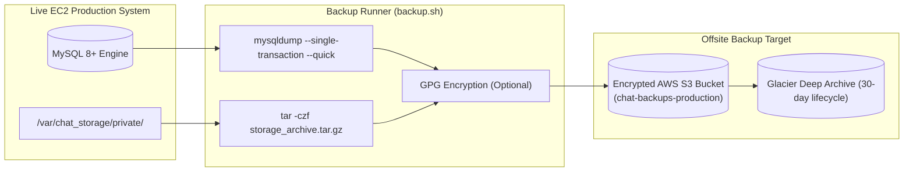

# Production Backup and Disaster Recovery Runbook

## 1. Overview & Recovery Objectives

To guarantee business continuity, data protection, and resilience against hardware failures or accidental data corruption, this platform implements automated backup and disaster recovery procedures.

- **Recovery Point Objective (RPO)**: <= 1 hour (via hourly database dumps and transaction logs).
- **Recovery Time Objective (RTO)**: <= 30 minutes (fully automated restoration script).

---

## 2. Backup Strategy

The backup regime preserves two critical data assets:
1. **MySQL 8+ Relational Database**: User accounts, conversations, messages, reactions, outbox records, and metadata.
2. **Private EBS Storage (`/var/chat_storage/private`)**: Encrypted media attachments, avatars, and chunked files.



---

## 3. Automated Backup Script (`deploy/scripts/backup.sh`)

The automated script handles database dumps, file archiving, compression, and cleanup of backups older than 7 days.

### Execution:
```bash
sudo /var/www/chat-app/deploy/scripts/backup.sh
```

### Script Key Parameters:
- **Consistent DB Dumps**: Uses `--single-transaction --quick --routines --triggers --set-gtid-purged=OFF` to ensure transactional consistency without locking tables.
- **Atomic Archives**: Generates timestamped archives:
  - `db_backup_YYYYMMDD_HHMMSS.sql.gz`
  - `storage_backup_YYYYMMDD_HHMMSS.tar.gz`
- **Automated S3 Sync**: Transmits archives to `s3://chat-app-backups/` if AWS CLI is configured.

### Setting Up Automated Cron:
Add to root crontab (`sudo crontab -e`):
```cron
# Run daily full backup at 02:00 UTC
0 2 * * * /var/www/chat-app/deploy/scripts/backup.sh >> /var/log/chat_backup.log 2>&1
```

---

## 4. Disaster Recovery & Restoration Procedure (`deploy/scripts/restore.sh`)

In the event of database corruption, ransomware, or server migration, use the restoration script.

### Step 4.1: Stop Real-Time Ingestion Services
Prevent data writes during restoration:
```bash
sudo systemctl stop chat-asgi chat-outbox chat-celery chat-celery-beat
```

### Step 4.2: Execute Restoration Script
```bash
sudo /var/www/chat-app/deploy/scripts/restore.sh \
    /var/backups/chat/db_backup_20261108_020000.sql.gz \
    /var/backups/chat/storage_backup_20261108_020000.tar.gz
```

The script:
1. Decompresses the SQL dump.
2. Restores the schema and rows into `chat_db`.
3. Clears and extracts the media files into `/var/chat_storage/private`.
4. Restores correct file ownership (`www-data:www-data`) and permissions (`770`).

### Step 4.3: Run Database Migrations (Schema Verification)
```bash
cd /var/www/chat-app/django_server
source venv/bin/activate
python manage.py migrate --check
```

### Step 4.4: Restart Production Services
```bash
sudo systemctl start chat-asgi chat-outbox chat-celery chat-celery-beat
sudo systemctl reload nginx
```

---

## 5. Disaster Recovery Testing Cadence

- **Monthly**: Automated restoration test into an isolated staging environment.
- **Quarterly**: Full disaster recovery drill simulating complete EC2 instance rebuild from EBS snapshots and offsite backups.

