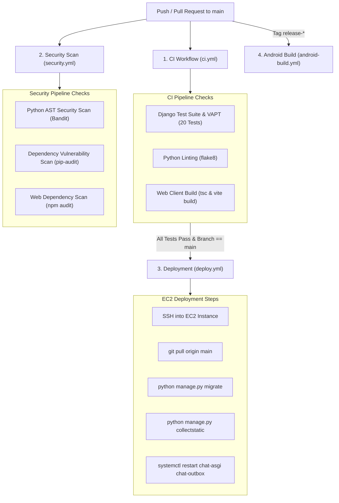

# Continuous Integration and Deployment (CI/CD) Pipelines

## 1. Overview & Pipeline Architecture

The repository incorporates automated **GitHub Actions** workflows designed to enforce code quality, verify security controls, build client bundles, produce signed Android binaries, and perform zero-downtime EC2 deployments.



---

## 2. Inventory of GitHub Actions Workflows

All workflows are located in `.github/workflows/`:

| Workflow File | Trigger Events | Primary Responsibilities |
| :--- | :--- | :--- |
| `ci.yml` | `push: [main, develop]`, `pull_request` | Sets up Python 3.12, runs Django test suite (including VAPT suite), lints with flake8, builds React web client with Vite. |
| `security.yml` | `schedule: [weekly]`, `push: [main]` | Executes Bandit static code analysis, runs `pip-audit` against Python packages, and runs `npm audit` on web dependencies. |
| `deploy.yml` | `push: [main]` (after CI passes) | Authenticates via SSH, pulls latest code on EC2, runs migrations, builds web frontend, and restarts systemd services with zero downtime. |
| `android-build.yml` | `push: tags: ['v*']` or manual | Sets up JDK 17 & Android SDK, runs Expo prebuild, compiles signed release APK and release AAB, and uploads build artifacts. |

---

## 3. Required GitHub Repository Secrets

Configure the following secrets in GitHub under **Settings > Secrets and variables > Actions**:

### Deployment Secrets (for `deploy.yml`):
- `EC2_HOST`: Elastic IP address or public DNS hostname of the EC2 instance.
- `EC2_USER`: SSH username (e.g. `ubuntu`).
- `EC2_SSH_KEY`: Private SSH key (PEM format) with access to the instance.

### Android Release Secrets (for `android-build.yml`):
- `ANDROID_KEYSTORE_BASE64`: Base64-encoded string of `chat-app-release.keystore`.
- `ANDROID_KEYSTORE_PASSWORD`: Keystore master password.
- `ANDROID_KEY_ALIAS`: Key alias name (e.g., `chat-app-key`).
- `ANDROID_KEY_PASSWORD`: Password for the key alias.
- `GOOGLE_SERVICES_JSON_BASE64`: Base64-encoded `google-services.json` file.

---

## 4. Zero-Downtime Deployment Flow (`deploy/scripts/deploy.sh`)

When `deploy.yml` executes on EC2, it triggers `deploy/scripts/deploy.sh`:

1. Verifies that MySQL and Redis services are active.
2. Backs up the current codebase commit hash for rollback support.
3. Pulls latest release commit from Git.
4. Upgrades Python virtual environment dependencies.
5. Applies database schema migrations: `python manage.py migrate --noinput`.
6. Compiles React production bundle: `npm --prefix ../client run build`.
7. Collects Django static assets: `python manage.py collectstatic --noinput`.
8. Gracefully reloads systemd services:
   ```bash
   sudo systemctl reload-or-restart chat-asgi
   sudo systemctl restart chat-outbox
   sudo systemctl restart chat-celery
   sudo systemctl restart chat-celery-beat
   sudo systemctl reload nginx
   ```
9. Performs an automated HTTP health check against `https://chat.yourdomain.com/health/`; rolls back automatically if health check fails.

