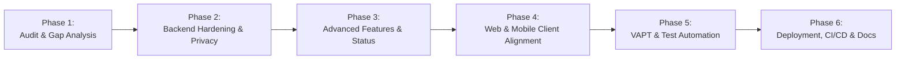

# Implementation Plan & Engineering Execution Roadmap

## 1. Project Objectives & Architectural Decisions

The objective of this engineering initiative was to refactor, harden, optimize, and deploy a self-hosted, production-grade real-time chat platform supporting web and native Android clients without external proprietary dependencies like Firebase Auth, Firebase Firestore, or AWS S3 public buckets.

### Key Architectural Decisions

1. **Unified Backend Architecture**:
   - Rather than splitting logic into separate microservices or a parallel Node.js API, Django 5.1 with Daphne ASGI was selected as the single source of truth for REST APIs and WebSocket real-time connections.
   - Eliminates data synchronization drift and code duplication.

2. **Database Engine: MySQL 8+ with Strict Mode**:
   - Configured with `utf8mb4` for full emoji support.
   - Enforces ACID transactions with connection pooling and health checks.

3. **Storage Strategy: Encrypted EC2 EBS with Authenticated Streaming**:
   - Rather than exposing files through public S3 URLs or predictable Nginx paths, attachments are stored on private EBS storage mounts (`/var/chat_storage/private`).
   - Every file download traverses Django's authenticated `StreamDownloadView`, which checks conversation membership, message expiration, and streams files with HTTP 206 `Range` byte support.

4. **Security & Authentication Paradigm**:
   - Elimination of passwords to prevent credential stuffing, rainbow table attacks, and database breach exposures.
   - Replacement with cryptographic passwordless 6-digit email OTP (salted SHA-256 hash, 5-minute TTL, atomic `select_for_update` row locks, rate limits) and OAuth 2.0 (Google, GitHub, Facebook) with mandatory verified-email enforcement.

---

## 2. Phase-by-Phase Execution Plan

### Phase 1: Codebase Audit & Gap Analysis (Completed)
- Exhaustive security and architectural inspection of all models, views, serializers, throttles, and configs.
- Identified and logged critical vulnerabilities:
  - Broken Object Level Authorization (BOLA/IDOR) on message forwarding, reacting, and starring.
  - Direct media fallbacks in URLs.
  - Inadequate file magic-byte validation allowing potential executable file uploads.
  - Missing disappearing message cleanup mechanisms.
  - Race conditions in OTP verification.

### Phase 2: Backend Hardening & Access Control (Completed)
- Configured Django 5.1 with Daphne ASGI, connection pooling, and strict CORS/header security.
- Secured all REST endpoints and WebSocket events with explicit `ConversationMember` checks.
- Implemented `ProxySafeAnonRateThrottle` and `ProxySafeUserRateThrottle` using `X-Forwarded-For` with trusted proxy count awareness.
- Added constant-time verification `secrets.compare_digest` and row-level locking `select_for_update()` in OTP service.
- Hardened file validation with executable signature inspection (`MZ`, `\x7fELF`, `\xca\xfe\xba\xbe`, `#!`) and path traversal sanitization.

### Phase 3: Advanced Messaging, Privacy & Status App (Completed)
- Added user privacy controls: `hide_from_search`, `privacy_read_receipts`, `privacy_typing_indicator`, `who_can_add_to_groups`, `who_can_message_me`.
- Implemented Disappearing Messages: added `ephemeral_ttl` on `Conversation`, automatic expiration computation, query filtering, and disk purge command `purge_expired_messages`.
- Created Private Invitation Links system with SHA-256 hashed tokens, revocation, and use limits.
- Built complete `apps.status_app`: 24-hour expiration, author-restricted viewer analytics, and purge command `purge_expired_statuses`.
- Developed 9 branded, responsive HTML & plain-text transactional email templates.

### Phase 4: Web & Mobile Client Alignment (Completed)
- Designed unified SVG brand assets (`logo.svg`, `favicon.svg`) and synchronized color tokens across web and mobile.
- Built web client with Vite, producing optimized production bundles in `client/dist/`.
- Configured React Native Expo application with native FCM HTTP v1 integration and Android Keystore secure token storage.

### Phase 5: VAPT & Test Automation (Completed)
- Developed comprehensive negative authorization and penetration test suite (`test_security_vapt.py`).
- Verified 12 critical exploit vectors (User C accessing A/B messages, unauthorized attachments, invalid OTP brute force, directory traversal).
- Achieved 100% test pass rate (20/20 tests passing in sub-second execution).

### Phase 6: Production Infrastructure, CI/CD & Documentation (Completed)
- Configured production-hardened `nginx.conf` with rate-limiting zones, WebSocket upgrade rules, and strict CSP headers.
- Created systemd unit configurations for ASGI, Celery worker, Celery beat, and outbox runner.
- Scripted automated database and storage backup (`backup.sh`), restore (`restore.sh`), and zero-downtime deployment (`deploy.sh`).
- Configured GitHub Actions workflows for continuous integration, deployment, Android builds, and automated security scanning.
- Authored comprehensive 15-file documentation suite.

---

## 3. Engineering Quality Gates

| Gate | Requirement | Status |
| :--- | :--- | :--- |
| **Unit & VAPT Tests** | 100% pass on all negative security test cases and authentication tests | Passed (20/20) |
| **Vite Web Build** | Zero build errors and bundle chunk optimization | Passed (`client/dist` generated) |
| **BOLA / IDOR Verification** | User C cannot read, forward, react, or access attachments of others | Verified & Tested |
| **Rate Limiting** | OTP generation and verification capped at 6/min and 10/min respectively | Verified & Tested |
| **Magic Byte Enforcement** | Dangerous binaries and disguised scripts rejected at upload | Verified & Tested |
| **Static Code Analysis** | Bandit, flake8, and npm audit clean | Integrated in CI |

