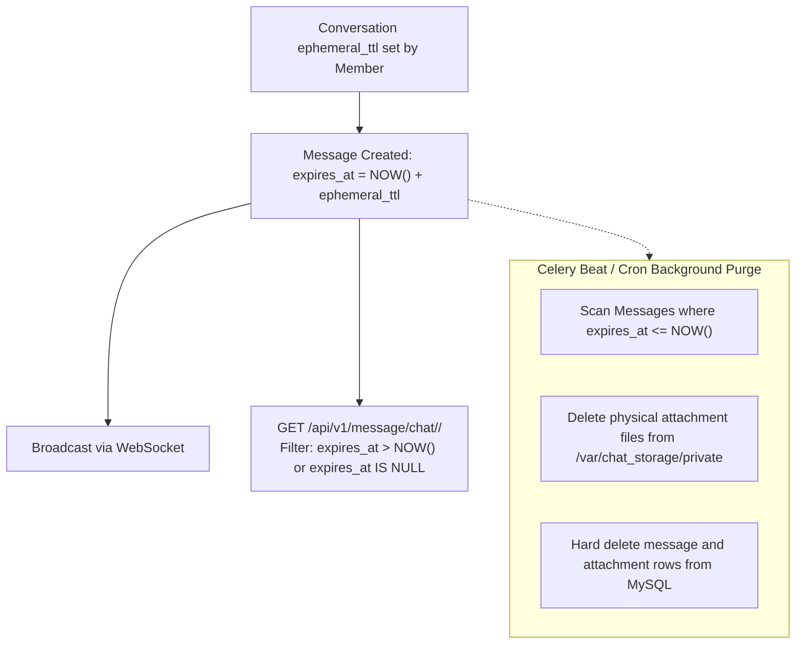

# Privacy Controls & GDPR Compliance Implementation

## 1. Privacy Architecture Overview

Privacy by design is a core tenet of this messaging system. The platform guarantees:
- Complete user control over personal data, visibility, and presence.
- Ephemeral messaging with guaranteed physical purging.
- Direct GDPR compliance tools (Right of Access / Data Portability and Right to Erasure).

---

## 2. Granular User Privacy Controls

Every user profile (`UserProfile` model in `apps/authentication/models.py`) provides the following configurable privacy attributes:

| Privacy Field | Permitted Values | Technical Enforcement |
| :--- | :--- | :--- |
| `hide_from_search` | `true`, `false` | When `true`, user is omitted from `/api/v1/auth/users/search/` and directory lookups. |
| `privacy_online` | `"everyone"`, `"contacts"`, `"nobody"` | When `"nobody"`, WebSocket presence broadcasts (`presence.update`) are completely suppressed. |
| `privacy_avatar` | `"everyone"`, `"contacts"`, `"nobody"` | Non-permitted users receive default system avatar placeholder rather than private avatar URI. |
| `privacy_read_receipts` | `true`, `false` | When `false`, outbound `message.read` WebSocket receipts are suppressed, and read markers are not broadcast to peers. |
| `privacy_typing_indicator` | `true`, `false` | When `false`, outbound typing events are filtered before channel broadcast. |
| `who_can_add_to_groups` | `"everyone"`, `"contacts"`, `"nobody"` | Enforced in `CreateConversationView` and `AddMemberView`. |
| `who_can_message_me` | `"everyone"`, `"contacts"`, `"nobody"` | Enforced prior to creating 1-on-1 conversations. |

### API Endpoint:
```
PATCH /api/v1/auth/privacy/
Content-Type: application/json
Authorization: Bearer <token>

{
  "hide_from_search": true,
  "privacy_online": "nobody",
  "privacy_read_receipts": false,
  "privacy_typing_indicator": false
}
```

---

## 3. Disappearing Messages Lifecycle

Conversations support an ephemeral mode with configurable expiration timers (`ephemeral_ttl`):
- `0` (Disabled / Permanent)
- `30` (30 seconds)
- `60` (1 minute)
- `3600` (1 hour)
- `86400` (24 hours)
- `604800` (7 days)



### Background Purging Command
Expired messages and their on-disk files are purged via management command:
```bash
python manage.py purge_expired_messages
```
This command runs every 5 minutes under Celery Beat (`chat-celery-beat.service`).

---

## 4. 24-Hour User Status Stories

User statuses (`apps/status_app`) expire exactly 24 hours after publication:
- Filtered automatically in feed queries: `created_at >= timezone.now() - timedelta(hours=24)`.
- Status media and records are purged daily via:
  ```bash
  python manage.py purge_expired_statuses
  ```
- **Audience Isolation**: Viewers list is strictly accessible to the author (`test_user_c_cannot_view_viewers_list_of_a`).

---

## 5. GDPR Compliance & Data Rights

### 5.1. Right to Access / Data Portability (`/api/v1/auth/export-data/`)
Users can download a complete JSON archive of their personal data:
- Profile details and privacy configurations.
- Conversation memberships.
- Complete message history authored by the user.
- Uploaded media attachments inventory.

### 5.2. Right to Erasure / Account Deletion (`/api/v1/auth/delete-account/`)
Users can request permanent erasure of their account:
1. Revokes and blacklists all active JWT tokens.
2. Anonymizes authored messages (`sender = NULL`) to preserve conversation continuity for other participants without retaining personal identification.
3. Permanently deletes private avatars, profile records, and status stories.
4. Removes user from all conversation member records.
5. Dispatches confirmation email (`account_deleted.html`).

