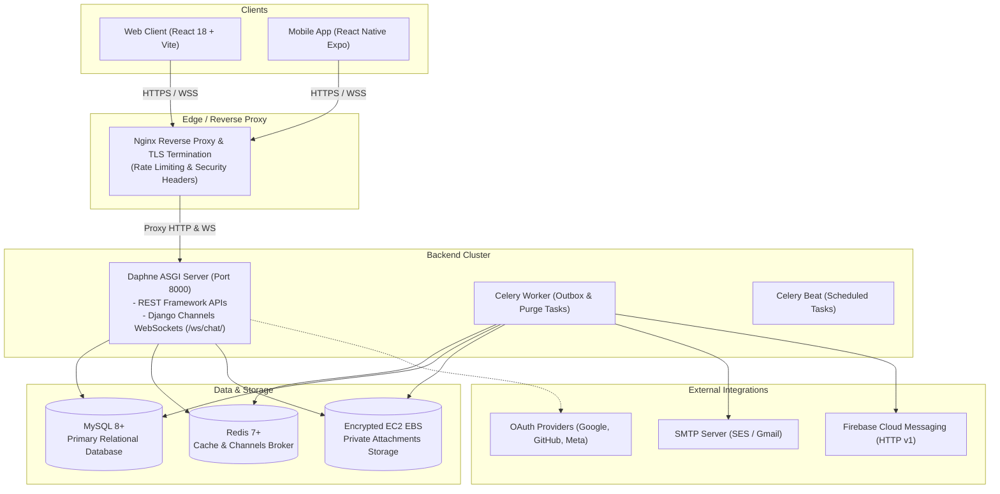

# Secure Real-Time Messaging Platform - Project Overview

## 1. Executive Summary

This repository contains an enterprise-grade, self-hosted, end-to-end real-time communication platform designed to provide privacy, high throughput, zero-compromise access control, and low-latency delivery.

The platform consists of:
- **Primary Backend**: Python 3.12+ Django 5.1 running under Daphne ASGI, using Django REST Framework for HTTP APIs and Django Channels for WebSocket handling.
- **Relational Storage**: MySQL 8.0+ configured with utf8mb4 charset and strict ACID transactions.
- **Cache & Channel Layer**: Redis 7.0+ for session caching, distributed rate limiting, and Channels pub/sub.
- **Private Attachment Storage**: Direct EC2 EBS local filesystem storage with path-traversal hardening, MIME magic header sniffing, and authenticated streaming (supporting HTTP 206 partial content/range requests). Public or direct Nginx access to media files is strictly blocked.
- **Web Frontend**: React 18, TypeScript, Tailwind CSS, Lucide icons, Vite, TanStack Query, and Zustand.
- **Mobile Frontend**: React Native with Expo bare workflow, Native FCM (Firebase Cloud Messaging HTTP v1), secure Keystore token management, and TypeScript.
- **Security & Privacy Layer**: Zero passwords, zero SMS OTP, and zero Firebase Auth/Firestore dependencies. Authentication is strictly cryptographic passwordless Email OTP and OAuth 2.0 (Google, GitHub, Facebook) with verified email checks and state anti-CSRF protection.

---

## 2. System Architecture



---

## 3. Core Capabilities & Feature Matrix

| Feature | Description | Architecture / Implementation |
| :--- | :--- | :--- |
| **Passwordless Authentication** | 6-digit cryptographic OTP sent via transactional email | Salted SHA-256 hash in DB, 5-minute TTL, 60s cooldown, max 5 attempts, constant-time `secrets.compare_digest`, atomic `select_for_update` locking. |
| **OAuth 2.0 Integration** | Social login via Google, GitHub, and Facebook | Cryptographic CSRF `state` validation, strictly verified email verification, anti-account hijacking protections. |
| **Real-Time Messaging** | Low-latency 1-to-1 and group chats | Django Channels over WebSocket (`/ws/chat/`), backed by Redis channel layers. |
| **Message Isolation (Zero IDOR)** | User C cannot access conversations of User A and B | Strict SQL join membership checks (`ConversationMember`) on every REST request and WebSocket event. |
| **Private File Storage** | Resumable chunked uploads and direct uploads | Stored under private EBS directory (`STORAGE_ROOT`). Zero predictable URLs. Streamed via Django view verifying user membership and message expiration. |
| **Disappearing Messages** | Ephemeral messaging with configurable TTL | Ephemeral TTLs (30s, 1m, 1h, 24h, 7d). Auto-hidden from queries after expiration; purged from disk and DB via background worker. |
| **Status / Stories** | 24-hour visual updates | Text, image, or video statuses with privacy controls (all, contacts, nobody), reaction support, and viewer tracking strictly limited to the author. |
| **Privacy Controls** | Granular user privacy options | Hide from search, hide avatar, hide online presence/last seen, disable read receipts, and disable typing indicators. |
| **Private Invitation Links** | Shareable links for direct or group conversations | SHA-256 hashed tokens, expiration timestamps, maximum use counts, and one-click revocation. |
| **Push Notifications** | Background alerts for messages and updates | Android: Direct FCM HTTP v1 using Google service account keys. Web: Web Push using VAPID keys. |

---

## 4. Repository Structure

```
d:/personal/chat-app/
├── .github/workflows/          # CI/CD: Tests, Deployment, Android Build, Security Scans
│   ├── ci.yml
│   ├── deploy.yml
│   ├── android-build.yml
│   └── security.yml
├── client/                     # React 18 Web Application (Vite + TypeScript)
│   ├── public/                 # Static assets (logo.svg, favicon.svg)
│   ├── src/                    # Components, contexts, hooks, pages, services
│   └── package.json
├── mobile/                     # React Native Expo Mobile App (TypeScript)
│   ├── src/                    # Screens, navigation, store, services, constants
│   ├── app.json                # Expo config & FCM plugins
│   └── eas.json                # EAS build profiles
├── django_server/              # Django Daphne ASGI Backend
│   ├── apps/
│   │   ├── authentication/     # User model, OTP, OAuth, privacy, profile APIs
│   │   ├── chat/               # Conversations, members, invitation links
│   │   ├── messages_app/       # Messages, reactions, disappearing messages, outbox
│   │   ├── storage_app/        # Resumable chunks, file validation, private streaming
│   │   ├── status_app/         # 24h user statuses, viewer logs, status reactions
│   │   ├── notifications/      # FCM HTTP v1 & VAPID Web Push dispatchers
│   │   ├── realtime/           # WebSocket consumers, connection management
│   │   └── outbox/             # Transactional outbox pattern for reliable dispatch
│   ├── core/                   # Django settings, ASGI routing, URL routing
│   ├── templates/emails/       # HTML & text branded transactional emails
│   ├── manage.py
│   └── requirements.txt
├── deploy/                     # Deployment configurations
│   ├── systemd/                # ASGI, Outbox, Celery, and Beat systemd units
│   └── scripts/                # Automated backup, restore, and deployment bash scripts
├── docs/                       # Complete 15-file technical documentation suite
├── nginx.conf                  # Production Nginx reverse proxy configuration
├── .env.example                # Non-secret environment variable template
└── README.md                   # Repository overview and quickstart guide
```

---

## 5. Technology Stack Specifications

- **Python**: 3.12+ (compatible with Python 3.12, 3.13, 3.14, 3.15)
- **Django**: 5.1.x
- **Django Channels**: 4.1.x
- **Daphne**: 4.1.x
- **Database**: MySQL 8.0+ with PyMySQL adapter
- **Cache & Message Broker**: Redis 7.0+
- **Frontend Web**: React 18, Vite 5, TypeScript 5, Tailwind CSS, TanStack Query v5
- **Mobile Application**: React Native 0.74+, Expo SDK 51+, TypeScript
- **WebSockets Protocol**: JSON frames with authentication via JWT query token / cookie
- **Push Protocols**: Google Firebase Cloud Messaging HTTP v1 API, RFC 8291 Web Push

